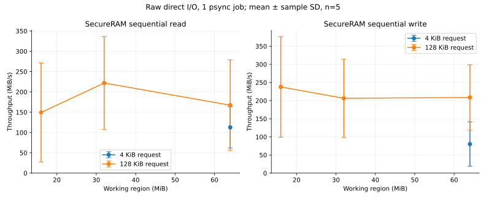
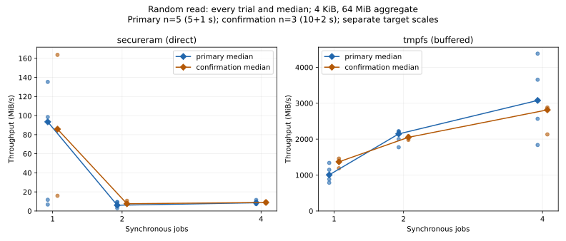
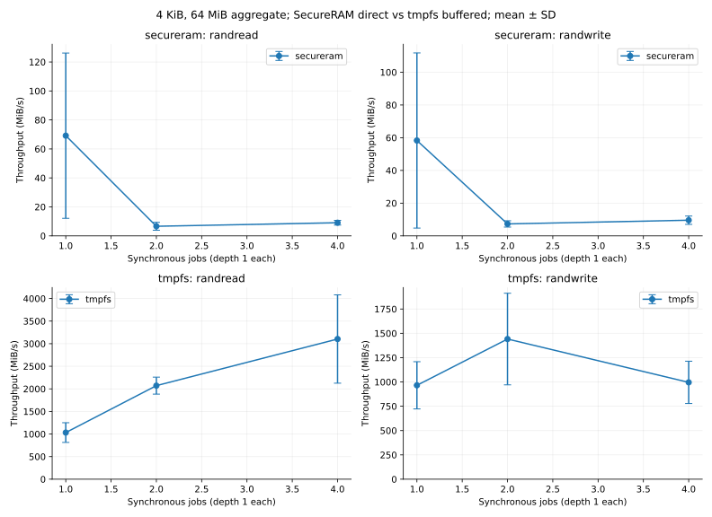
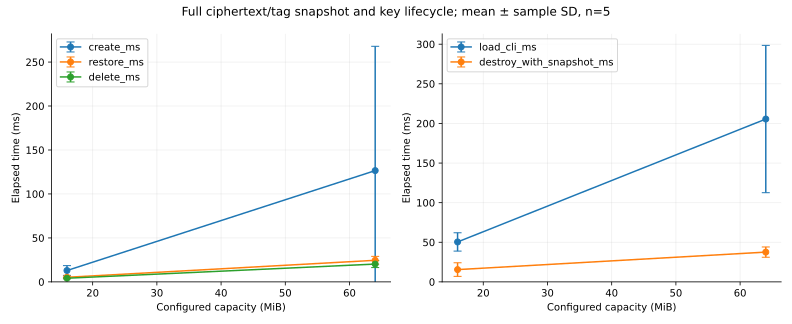
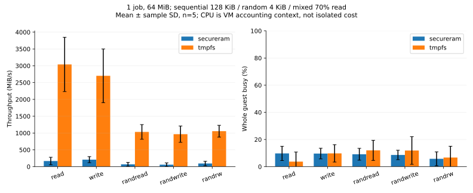

# M10 performance evaluation: design and evidence

## Baseline and experimental contract

Started from clean `main` at `35babfa96367296b8e2451a3d028fb4a88610f99`.
The complete M9 local runner passed before creating `m10-performance-evaluation`;
`.cache/m10-baseline.log` retains the transcript. M9's accepted 45/45 real-VM
campaign is inherited, not repeated. No production code was changed.

This design was written before benchmark implementation and measurements.
M10 is complete: 150 primary I/O trials, 10 lifecycle trials and security demos
passed, followed by a separate 18-trial confirmation. The recovery/provenance
record below preserves the original harness failure and every measurement.
Version 0.8.0, ABI 1 and production features 31 remain unchanged.

## Questions, variables and controls

All I/O uses fio psync, depth 1 per job, monotonic clock, deterministic seed
10000+trial, identical aggregate regions and disjoint worker slices. Production
SecureRAM uses raw O_DIRECT; tmpfs uses buffered pread/pwrite because its page
cache is its RAM storage. No drop_caches, filesystem formatting or real-disk
benchmarking. All trials are retained; no automatic outlier exclusion.

| Question | Independent variable | Controls | Measurement / interpretation |
| --- | --- | --- | --- |
| Sequential speed and request overhead? | read/write; 4/128 KiB requests | 1 job; default capacity; same region | MiB/s, latency, duration; larger requests amortize submission but retain per-unit crypto |
| Working-set sensitivity? | capacity/4, capacity/2, capacity | 128 KiB sequential read/write, 1 job | MiB/s; distinguish working set from transferred bytes in time-based loops |
| Random and mixed cost? | randread/randwrite/randrw 70% reads | 4 KiB, full region, 1 job | IOPS, MiB/s, weighted mean latency; all units initialized |
| Concurrency saturation? | 1/2/4 jobs, capped by vCPUs | random 4 KiB read/write; fixed aggregate size | aggregate throughput/IOPS, latency; no expectation of linear scaling |
| Practical RAM baseline gap? | SecureRAM vs private tmpfs file | same parameters except required direct mode | paired throughput ratio; includes different layers, never isolated crypto overhead |
| Snapshot cost vs capacity? | default/4 and default capacities | full A -> snapshot -> B -> restore -> full exact A | monotonic ioctl create/restore/delete milliseconds, correctness outside timing |
| Key lifecycle cost? | same two capacities | no open block users, protected CLI-generated keys | load CLI wall ms (includes process/random/HKDF/full encrypted-zero initialization); destroy ioctl ms |
| Resource cost? | same I/O configurations | record before/after /proc/stat and vmstat | guest busy/steal, swap deltas; includes worker and background guest activity, not crypto attribution |
| Memory cost? | capacity; snapshot absent/present | exact implementation allocations | C + C/4096*32, doubled with slot, plus 8192 staging and metadata/provider costs |
| Security properties observable? | existing M4/M5 test build | bounded private hooks only, no keys/backing export | internal backing comparison, EIO/latch, exact rollback, destroy/generation denial |

Full mode: 5 trials, 5 measured seconds plus 1-second warmup per fio case.
Quick mode: 3 trials, 2 measured seconds plus 1-second warmup, same matrix.
At 4 vCPUs there are 15 configurations per target (150 full I/O trials).
Case order alternates target order by trial; configurations are seeded-shuffled.
Each fio process has a 45-second timeout; I/O has a 35-minute timeout and the
whole campaign has a 45-minute deadline.
Control operations use 5 (full) or 3 (quick) repetitions per capacity.

## Environment and sizing rationale

Preflight observed SecureRAM-Ubuntu with 4 vCPUs, 6144 MiB configured RAM,
5920 MiB guest-visible RAM, approximately 4737 MiB available, zero swap used,
Linux 7.0.0-38-generic. These were captured again for each campaign. Default capacity
comes from include/secureram_config.h (64 MiB); use it only if a conservative
eight-capacity memory budget fits within one quarter of MemAvailable and tmpfs
has twice-capacity free. Otherwise reduce by powers of two, minimum 4 MiB.
Actual regions: 16/32/64 MiB, lifecycle capacities: 16/64 MiB.
These are derived from actual limits, not arbitrary transfer volumes.

fio was absent; its Ubuntu package was installed for established JSON throughput,
latency and worker accounting. Recorded version: fio 3.36. See the primary
[fio documentation](https://fio.readthedocs.io/en/latest/fio_doc.html) for psync,
numjobs, offset_increment, runtime, ramp_time and JSON semantics. brd is present,
but tmpfs is selected to keep writes confined to the existing fixed SecureRAM
device and a newly created private file. It is a practical use-case baseline,
not a block-stack equivalent. Never label the gap encryption-only overhead.

## Security and memory boundaries

There is no supported encryption-only configuration in the current production
architecture. Component isolation is SKIP: no security-disable switch or altered
crypto build will be added. Normal benchmark builds exclude all test hooks.
Separate M4/M5 builds demonstrate internal comparisons and bounded corruption.
Successful writes with M4_TEST prove actual stored bytes equal cipher staging
and differ from plaintext; bytes are never exported. This is a deterministic
demonstration, not a cryptographic proof or defense against a hostile kernel.

`secureram_store_init` allocates C ciphertext bytes and 32 bytes per 4096-byte
unit with vzalloc. Snapshot create allocates and copies another complete pair,
even for logically empty units. Restore copies the pair; delete explicitly zeros
then frees it. Two kzalloc staging units add 8192 bytes. Tag overhead is exactly
0.78125% of C; one snapshot adds 100.78125% of C. The live security/device structs
embed slot metadata, counters, locks and pointers. blk-mq allocates 64 requests
with `sizeof(struct secureram_request)` private bytes each, plus kernel request,
tag, disk/queue and ordered-workqueue allocations. Crypto transform/request and
shash descriptor costs depend on the chosen provider and kernel configuration;
the latter is `sizeof(struct shash_desc)+crypto_shash_descsize(mac)`. Allocator
rounding, vmalloc page arrays/page tables and slab overhead are additional.
These formulas are accounted payload allocations, not a claim of total resident
footprint. Guest MemAvailable deltas are noisy context, not per-driver accounting.

## Evidence policy

Use `.cache/m10-benchmarks/<run-id>/`: environment and parameters, every fio JSON,
resource snapshots, lifecycle JSON, security logs, fresh kernel log and status,
derived CSV/statistics and graphs. Record failed campaigns unchanged. Report mean,
median, min, max, sample standard deviation and sample count. Flag coefficient
of variation above 10%; never silently exclude it. Host load/swap is observed
from the host separately; guest counters cannot rule out host contention.
No timing, PASS, security claim or final conclusion is entered before execution.

## Targeted confirmation design (after the primary campaign)

The primary campaign's SecureRAM throughput CV ranges from 17.8% to 91.8%,
and 2/4-job random reads are much slower than 1-job reads. Before collecting
additional data, define this focused question: does the negative random-read
scaling persist with a longer observation window? Vary only 1/2/4 jobs; keep
64 MiB aggregate regions, 4 KiB requests, psync depth 1, the same seeds and
target modes. Use 3 trials per target/configuration, 10 measured seconds and
2 seconds warmup. Keep this 18-trial experiment separate; do not replace,
discard or pool any primary sample. It does not repeat completed lifecycle or
security demonstrations. No driver change or optimization is justified by the
current evidence. Inspect raw operation counts, latency, driver byte counters
and system/resource observations to distinguish data-path execution from cache
or aggregation artifacts; VM scheduling remains an unisolated confounder.

## Executed campaigns and provenance

Runs started on 14 October 2026 UTC (15 October IST), in the existing
`SecureRAM-Ubuntu` VirtualBox VM. Ubuntu 24.04.5 LTS, x86_64, GCC 13.3.0,
Python 3.12.3, 4 vCPUs and 6144 MiB configured RAM were recorded. Guest CPU
identifies Intel Core i7-1255U; VirtualBox exposes KVM paravirtualization, so
`lscpu`'s hypervisor label is not a different execution environment. The host
has about 16 GiB physical RAM. No CPU pinning, fixed frequency or dedicated
host isolation was used. Guest swap capacity is 4 GiB, with zero swap used
and zero pswpin/pswpout deltas in every accepted I/O trial.

| Run | Exact candidate | Executed work / outcome |
| --- | --- | --- |
| `20261014T185015Z-5889` | `f9b4459a5cca07a27d85678bc085eef6aa0967ee` | 150/150 I/O trials PASS; later harness CLI error; overall FAIL retained |
| `20261014T191200Z-7182` | `dcc3c603d389d6c5b6ff5e203fbd9d3d1e2d832f` | validated original I/O reused; 10 lifecycle trials, demos, final production, analysis, health and cleanup; **8/8 PASS, exit 0** |
| `20261014T191843Z-8451` | `c26471978da2b79b930869fed6aa4df47cd4430f` | 18 longer random-read trials, production build, analysis, health and cleanup; **5/5 PASS, exit 0** |

The first run called `load-random --json`, unsupported by the existing CLI.
This failed before lifecycle timing; it was a measurement-harness defect, not
a driver defect. The narrow CLI fix and regression test distinguish actions
from JSON observations. Resume verified identical I/O logic, parameters and
unchanged production sources before importing all raw trials. The failed
summary remains FAIL; its common finalizer labels cleanup FAIL whenever the
suite aborts, rather than asserting that a particular resource leaked. The
subsequent clean preflight, successful campaigns and independent postcheck
establish resource cleanup. No completed campaign was rerun on resumption.

[Raw audit](evidence/m10/raw-audit.json) verified all **450 reused fio JSON,
metadata and stderr files byte-identical**, all 302 primary and 36 confirmation
raw input hashes, and the complete planned matrices. It also checked actual
commands, fixed aggregate slice sizes, seeds, direct modes, `io_bytes = I/Os ×
request size`, bandwidth/IOPS/runtime consistency and SecureRAM byte counters.
Driver byte deltas exceed measured fio bytes (they also cover warmup); no
integrity failures or guest swap deltas occurred. Every timed trial was followed
by exact full-region content validation outside its timing window.

Bulk raw evidence stays in ignored `.cache/m10-real-vm/m10-benchmarks/` on the
host and `.cache/m10-benchmarks/` in the guest. Original and resumed transfer
archives are retained. [Selected evidence and inventory](evidence/m10/README.md)
includes per-trial CSV, all descriptive statistics, hashes, provenance, kernel
logs and plots. No trial is discarded, pooled across campaigns or relabeled.

## Sequential, random and baseline results

Below: primary 64 MiB region, one job, mean ± sample SD over 5 trials. Latency
is each trial's operation-count-weighted mean, then averaged across trials.
IOPS is retained for all cases in CSV; it is most useful for 4 KiB random I/O.

| Workload | Request | SecureRAM MiB/s | tmpfs MiB/s | SecureRAM mean latency, us |
| --- | --- | ---: | ---: | ---: |
| Sequential read | 128 KiB | 167.29 ± 111.58 | 3039.12 ± 806.75 | 1110.81 |
| Sequential write | 128 KiB | 208.64 ± 90.27 | 2701.51 ± 798.64 | 747.42 |
| Sequential read | 4 KiB | 112.78 ± 50.76 | 1393.00 ± 355.66 | 43.82 |
| Sequential write | 4 KiB | 80.03 ± 61.30 | 1425.62 ± 85.81 | 99.65 |
| Random read | 4 KiB | 69.15 ± 57.02 | 1032.65 ± 218.06 | 201.28 |
| Random write | 4 KiB | 58.29 ± 53.52 | 965.54 ± 242.57 | 262.23 |
| Random mixed, 70% reads | 4 KiB | 93.29 ± 65.77 | 1054.67 ± 175.30 | 106.89 |

The complete machine-generated [table](evidence/m10/analysis.md) and
[statistics CSV](evidence/m10/summary.csv) contain n, mean, median, min, max
and sample SD for throughput, IOPS, latency, elapsed time and CPU observations.
Time-based runs transfer more than one region: elapsed CSV includes process
startup and warmup, whereas fio bandwidth uses its measured interval.

For 128 KiB sequential reads, 16/32/64 MiB region means are
149.46/222.02/167.29 MiB/s; writes are 237.59/206.40/208.64 MiB/s.
The fastest SecureRAM **configuration mean** is the 16 MiB sequential write
at 237.59 MiB/s (SD 138.65); the slowest is 2-job random read at 6.63 MiB/s.
These data do not establish a monotonic working-set effect. Larger requests
amortize dispatch and worker handoff, while still processing 4096-byte
authenticated units, but variability prevents a precise causal speedup claim.

Paired tmpfs/SecureRAM throughput ratios for 128 KiB read/write at 64 MiB
are **23.57x ± 11.23 / 14.85x ± 5.78**. These are means of the five paired
ratios; they are intentionally not ratios of aggregate means. Raw direct
block I/O avoids the block page cache, while buffered tmpfs uses the page
cache as storage. This is practical system-level overhead, including block
dispatch, synchronous waits, worker scheduling, encryption and integrity.
It cannot be assigned to AES or HMAC separately. Component-isolation is
**SKIP**, since no existing safe production mode supports it.

## Concurrency anomaly and focused confirmation

| Random read, 4 KiB / 64 MiB | 1 job | 2 jobs | 4 jobs |
| --- | ---: | ---: | ---: |
| Primary SecureRAM mean MiB/s, n=5 | 69.15 | 6.63 | 9.08 |
| Confirmation SecureRAM mean MiB/s, n=3 | 88.46 | 8.61 | 9.00 |
| Primary SecureRAM median MiB/s | 93.42 | 6.06 | 8.64 |
| Confirmation SecureRAM median MiB/s | 85.79 | 7.58 | 8.97 |
| Primary tmpfs mean MiB/s | 1032.65 | 2071.17 | 3103.46 |
| Confirmation tmpfs mean MiB/s | 1339.61 | 2038.42 | 2609.15 |

**Classification: reproducible SecureRAM/VM negative scaling, with substantial
measurement variability; no demonstrated production correctness bug or proven
accidental inefficiency.** Longer windows reproduce the direction and roughly
8–9 MiB/s multi-job band. All confirmation single-job samples
(85.7945, 15.9519, 163.6227 MiB/s) exceed all confirmation multi-job samples
(maximum 10.7005 MiB/s). Primary one-job samples range 6.79–135.29 MiB/s and
overlap multi-job samples, so the effect is not universal on every trial.
One-job CV stays high (82.46% primary, 83.51% confirmation); 4-job CV drops
from 17.80% to 8.13%. Doubling the window does not eliminate the variability.
The [comparison table](evidence/m10/confirmation-comparison.md) preserves every
individual SecureRAM sample and separate descriptive statistics for both targets.

Confirmation mean latency rises from 103.26 to 927.42 to 1735.33 us as jobs
increase. Individual synchronous IOPS × mean latency is consistent with
time spent waiting/servicing I/O, and raw byte/IOPS/runtime relationships are
consistent. This is not a missing-job aggregation error, uninitialized read,
unit conversion error or block-page-cache hit. Driver counters prove actual
execution through the secured path. None of these checks isolates scheduling
delay from service time.

Source inspection establishes one ordered workqueue draining a bounded list
and shared crypto staging. Additional fio jobs do not create parallel crypto
workers. Extra submission/completion handoffs and contention in this serialized
path are plausible contributors, with VirtualBox scheduling a confounder.
Serialization explains why linear scaling is not expected; **it alone does not
prove the cause of the observed large slowdown**. No scheduler traces, CPU
affinity controls or bare-metal experiment were collected, so do not call this
an intrinsic AES/HMAC limit, a confirmed driver defect or a universal hardware
result. Highest observed mean was at one job; a global saturation point is
not established. Existing evidence answers the focused question sufficiently;
additional experiments would expand causal profiling beyond this milestone.

Primary random-write means also fall from 58.29 to 7.31 to 9.58 MiB/s at
1/2/4 jobs. This direction is consistent with random reads, but random writes
were not independently confirmed. tmpfs writes peak at 2 jobs in this small
matrix (965.54/1441.23/995.69 MiB/s); no general scaling law is inferred.

## Snapshot, lifecycle and security results

Each capacity has five trials; operation timings use a monotonic clock.
Full-device A/snapshot/B/restore/A comparisons, generation transitions,
destroyed-key denial and snapshot absence after destroy all passed.

| Operation | 16 MiB mean ± SD, ms | 64 MiB mean ± SD, ms |
| --- | ---: | ---: |
| Load random key through CLI | 50.405 ± 11.588 | 205.546 ± 92.951 |
| Snapshot create ioctl | 12.928 ± 5.523 | 126.561 ± 141.388 |
| Snapshot restore ioctl | 5.244 ± 1.334 | 24.549 ± 4.462 |
| Snapshot delete ioctl | 4.158 ± 0.731 | 20.262 ± 3.988 |
| Key destroy with populated snapshot ioctl | 15.505 ± 8.587 | 37.589 ± 6.504 |
| Lock/unlock pair, 100-pair batch mean | 0.0118 ± 0.0130 | 0.0081 ± 0.0029 |

Create copies and allocates the entire ciphertext/tag pair; restore copies;
delete wipes/frees. Cost depends on configured capacity, not just user-written
data. The 64 MiB create sample of **373.6279 ms is retained**, with median
90.6488 ms and range 34.6391–373.6279 ms. Two capacities and noisy allocation
timing do not establish a fitted complexity or precise linear scaling law.
Load includes process startup, protected randomness, HKDF and full authenticated
zero initialization. Destroy includes wiping a snapshot. Tiny lock/unlock batch
numbers include Python/ioctl overhead and are not precise isolated syscall costs.

The [security log](evidence/m10/security-demo.log) records successful existing
M4 internal stored-ciphertext equality/plaintext inequality checks and M5
ciphertext, tag and relocation corruption checks. Each corruption yields EIO,
leaves output untouched, latches failure, rejects further access and recovers
through destructive rekey. No plaintext, key or backing bytes are exported.
The normal production artifact was rebuilt and checked to exclude M4/M5/M9
hooks. These demonstrations retain M9's threat model: no claim against a
malicious kernel, live privileged memory inspection or persistence across reboot.

## CPU, host pressure and memory

Whole-guest busy observations for primary random reads are 9.12/18.85/30.78%
at 1/2/4 jobs; confirmation gives 7.08/19.79/24.55%. These include the kernel
worker and unrelated guest activity over startup, warmup and measurement.
fio process CPU excludes asynchronous worker execution. Some readings conflict
strongly: confirmation single-job trial 3 reports 32.39% of one core in fio
but only 0.83% whole-guest busy, less than the nominal four-vCPU equivalent.
Window differences and virtual CPU time accounting prevent reliable fine-grained
CPU attribution. **Per-encryption, per-integrity and per-driver CPU cost is
unresolved**, not zero; the CPU chart is observation context only.

Host samples span preparation as well as timed trials. Available host memory
fell to 472 MiB near initial build/startup and 994 MiB during the primary
campaign; confirmation samples stayed at or above 2235 MiB. Host CPU and page
input counters show competing activity. `PagesInput/sec` includes file-backed
faults and does not establish which process or pagefile was responsible. Thus
we cannot certify absence of host paging or attribute individual outliers to
it. No guest swap or OOM was observed. Conservative guest sizing avoids an
oversized device, but does not isolate this shared host. The reproducible
negative scaling under the separate confirmation window is useful evidence;
it does not convert these measurements into a controlled bare-metal estimate.

| Accounted allocation | 16 MiB capacity | 64 MiB capacity |
| --- | ---: | ---: |
| Ciphertext bytes | 16,777,216 | 67,108,864 |
| HMAC tag bytes | 131,072 | 524,288 |
| Two staging buffers | 8,192 | 8,192 |
| Live payload total | 16,916,480 | 67,641,344 |
| Payload with one snapshot | 33,824,768 | 135,274,496 |

At 64 MiB this is 64.5078125 MiB live / 129.0078125 MiB with snapshot,
before other metadata. Final production DWARF gives `secureram_device=816`,
`secureram_security=272`, `secureram_store=32`, `secureram_snapshot=80`,
`secureram_stats=88`, `secureram_control=88`, `secureram_request=16`,
`shash_desc=8` and `skcipher_request=80` bytes. Embedded structs must not be
added again to the device total. 64 request-private objects contribute another
1024 payload bytes, excluding kernel request objects. Crypto request/descriptor
sizes additionally include provider-specific context. See
[captured sizes](evidence/m10/structure-sizes.json) and `tests/m10-layout.py`.
Allocator overhead, vmalloc structures, page tables, transforms, disk/queue and
workqueue allocations remain extra; system memory deltas do not reliably
measure total per-driver residence.

## Validation, limitations and completion

The full inherited M9 local suite passed at the baseline: ABI/source/checkpatch,
sanitizer, CLI/dashboard/HTTP and production-exclusion checks. The M9 health
fixtures and harness orchestration checks passed; M10's focused six local
oracles passed. Real running-kernel production/test builds, inherited direct
raw I/O, production hook exclusion, kernel health and cleanup passed in M10.
The previous M9 **45/45 real-VM acceptance remains inherited**, not repeated.
There were no production edits and hence no new driver regression campaign.
Local WSL GCC 15 versus target GCC 13 and missing pahole/BTF warnings are
environmental; ShellCheck was unavailable. These do not become runtime claims.

Fresh marked logs for both completed runs have no attributed fault/warning.
An independent guest postcheck on 15 October at 05:13 UTC verified absence of
module, both nodes, mount, fio and private tmpfs files. The owned sudo keeper
had already exited. The guest remains at the exact confirmation candidate;
later host changes are analysis/presentation and evidence documentation only.

All primary SecureRAM throughput configurations have CV above 10% (17.8–91.8%).
Five primary and three confirmation trials are descriptive samples, not precise
confidence estimates; paired seeds do not remove time-varying host load.
Constant recognizable buffers verify correctness but do not sample content
diversity. Only psync depth 1 per job, up to four jobs and a 64 MiB device are
characterized. There is no filesystem use-case benchmark, async-depth sweep,
bare-metal result or isolated crypto-cost measurement. Larger requests do not
disable unit authentication. No result establishes a universal saturation point.

M10 fulfills the applicable Definition of Done with these limitations disclosed.
Only the harness CLI defect was fixed; no production bug/inefficiency was proven
or changed. No security was weakened. The milestone remains on
`m10-performance-evaluation`; no merge, push or M11 work was performed.

## Meaningful file inventory

- `scripts/run-m10-benchmarks.sh`: bounded, gated VM campaign/full/quick/resume/confirmation entry point.
- `tests/m10-benchmarks.py`: environment, safe fixed-target fio, repeated lifecycle and existing-hook demonstrations.
- `tests/m10-analyze.py`: raw validation, descriptive CSV/Markdown, primary SVG/PNG figures and retained-CSV replay.
- `tests/m10-compare.py`: separate confirmation statistics/figure and raw hash/parameter/counter audit.
- `tests/m10-layout.py`: read-only production DWARF structure-size extraction.
- `tests/check-m10-local.py`: six measurement, error and safety regression oracles.
- `tests/m5-vm-common.sh`, `tests/vm-report.sh`, `tests/check-m9-health.sh`: M10 profile reusing established lifecycle and strict health machinery.
- `README.md`, `docs/architecture.md`, `docs/development.md`, `tests/README.md`: milestone status, boundaries and tooling links.
- `docs/m10-report.md`, `docs/m10-testing.md`: design, measured analysis, provenance, limitations and exact reproduction.
- `docs/evidence/m10/`: retained evidence files, tables, five SVG/PNG figure pairs and separate confirmation evidence; every file is described in its [inventory](evidence/m10/README.md).
